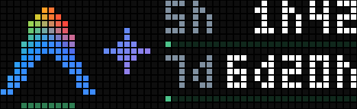

# Antigravity Quota Monitor (with AWTRIX clock display)

English | [正體中文](README.zh-TW.md)

An Antigravity plugin that tracks the **5-hour** and **weekly** limits of each model quota pool: time until reset, how fast you used it over the last hour, and when you will run out at that pace. If you have an AWTRIX clock (e.g. Ulanzi TC002), the numbers are pushed to it automatically.



| Antigravity edition | What you get |
|---|---|
| Antigravity desktop app (2.x) | Side panel + AWTRIX push + agent tools |
| Antigravity IDE, `agy` CLI | Agent tools (ask "how much quota is left?") + AWTRIX push |

```
Antigravity language server ──> panel sidecar (desktop app) ─┐
                            └─> MCP server (IDE / CLI) ──────┴─ one is elected ──PATCH──> AWTRIX clock (optional)
```

The IDE and the CLI do not start plugin sidecars, but they do start plugin MCP servers, so the same plugin works in both. When both are running, a `runner.json` lock file elects one of them to record history and push.

## Install (same on Windows, macOS and Linux)

Antigravity comes with the `agy` command. Install straight from GitHub:

```bash
agy plugin install https://github.com/patw0929/awtrix-antigravity-quota/tree/master/plugin/quota-monitor
```

Run the same command again to update. You can also copy the whole `plugin/quota-monitor` folder by hand to:

- macOS / Linux: `~/.gemini/config/plugins/quota-monitor`
- Windows: `%USERPROFILE%\.gemini\config\plugins\quota-monitor`

Keep the folder name `quota-monitor`. No `npm install` is needed (it runs on the Node.js that ships with Antigravity). Antigravity loads it automatically (it shows up under Customizations → Installed as Quota Monitor). Restart the IDE once for the agent tools to appear.

Open the panel (desktop app): open any conversation → Toggle Side Panel (top right) → Plugins → **Quota**.

## Side panel (desktop app)

- One card per quota pool (currently Gemini Models, and Claude and GPT models), listing the models that share it
- A bar each for the 5-hour and weekly windows, showing either remaining or used
- Time until reset; while you are using it, the last hour's pace, with a red warning if that pace runs out before the reset
- Usage over the last 24 hours
- Follows the Antigravity theme; English or Traditional Chinese depending on the system language

## Agent tools (IDE, CLI and desktop app)

- `quota_status`: remaining 5-hour and weekly quota per pool, time until reset, pace and estimated run-out
- `awtrix_configure`: set the clock IP, install or update the clock app, turn pushing on or off

Just ask the agent "How much Antigravity quota is left?" or "Set the AWTRIX clock to 192.168.1.50, install the app and turn on push."

## AWTRIX clock (optional, e.g. Ulanzi TC002)

Works with AWTRIX clocks running the 52×16 Berry-app firmware (`/api/v1`), for example the Ulanzi TC002.

The clock app is also listed on AWTRIX Hub: [Antigravity Quota](https://awtrix.de/script/TOM7hUZaUv46). Installing it from there or from the plugin gives the same app (`Antigravity-Quota`).

- Desktop app: panel → Settings → enter the clock IP → Save → Install / update clock app → tick Push to clock → Save
- IDE / CLI: ask the agent to call `awtrix_configure` (see above)

Settings live in a shared `settings.json`, so setting them in either place works. Updating the clock app keeps the settings already made on the clock.

On the clock:

- Left: the Antigravity mark, floating up and down; it floats faster as the pool fills up. Its shadow shows the state (green = fine, yellow = past the warning threshold, red = past the high threshold)
- Middle: the pool's model mark: the Gemini sparkle for the Gemini pool, the Claude burst for the Claude and GPT pool
- Right: `5h` and `7d` rows with percentage and bar, followed by a page with the time until reset

A red dot in the bottom-right corner means no update for 15 minutes (Antigravity closed). `WAIT` means no data has arrived yet.

Data is pushed only when the numbers change, plus once every 10 minutes, to spare the clock's flash memory.

## Development

```bash
agy plugin validate plugin/quota-monitor
```

```bash
cd plugin/quota-monitor/sidecars/panel && node --check main.mjs && node --check mcp.mjs
```

## License

[MIT](LICENSE)
