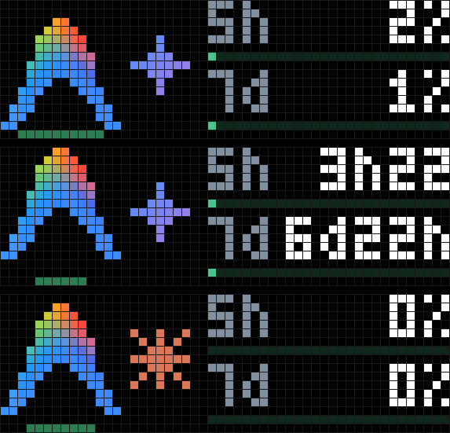

# Antigravity Quota Monitor（附 AWTRIX 時鐘顯示）

[English](README.md) | 正體中文

Antigravity 外掛：追蹤各額度池的 **5 小時**與**每週**用量、重置倒數、最近一小時的消耗速度，以及「照這速度多久用完」。有 AWTRIX 時鐘（例如 Ulanzi TC002）的話，數字會自動推送過去。



| 用哪個 Antigravity | 你會得到 |
|---|---|
| Antigravity 桌面版（2.x） | 側邊面板 ＋ AWTRIX 推送 ＋ agent 工具 |
| Antigravity IDE、`agy` CLI | agent 工具（問「額度還剩多少」）＋ AWTRIX 推送 |

```
Antigravity language server ──> 面板 sidecar（桌面版）─┐
                            └─> MCP server（IDE／CLI）─┴─ 選出一個 ──PATCH──> AWTRIX 時鐘（選用）
```

IDE 與 CLI 不會啟動外掛的 sidecar，但會啟動外掛的 MCP server，所以同一份外掛兩邊都能用。兩者同時在跑時，用 `runner.json` 鎖檔選出一個負責記錄與推送。

## 安裝（Windows／macOS／Linux 相同）

裝了 Antigravity 就有 `agy` 指令，一行從 GitHub 安裝：

```bash
agy plugin install https://github.com/patw0929/awtrix-antigravity-quota/tree/master/plugin/quota-monitor
```

更新時再跑一次同一行。也可以手動把 `plugin/quota-monitor` 整個資料夾複製到：

- macOS／Linux：`~/.gemini/config/plugins/quota-monitor`
- Windows：`%USERPROFILE%\.gemini\config\plugins\quota-monitor`

資料夾名稱要維持 `quota-monitor`，不需要 `npm install`（只需要 Antigravity 本身附的 Node.js）。Antigravity 會自動載入（可在 Customizations → Installed 看到 Quota Monitor）。IDE 要重開一次，agent 工具才會出現。

打開面板（桌面版）：進入任一對話 → 右上角 Toggle Side Panel → Plugins → **Quota**。

## 面板（桌面版）

- 每個額度池一張卡片（目前是 Gemini Models、Claude and GPT models），列出共用這個額度的模型
- 5 小時與每週各一條進度條，可切換顯示「剩餘」或「已用」
- 重置倒數；最近一小時有在用時顯示速度，照這速度會在重置前用完的話，用紅字提醒
- 近 24 小時用量曲線
- 顏色跟著 Antigravity 的主題；介面語言依系統（正體中文或英文）

## agent 工具（IDE、CLI、桌面版都有）

- `quota_status`：各額度池 5 小時／每週剩餘、重置倒數、速度與預估用完
- `awtrix_configure`：設定時鐘 IP、安裝／更新時鐘 app、開關推送

直接跟 agent 說「Antigravity 額度還剩多少？」或「把 AWTRIX 時鐘設成 192.168.1.50，安裝 app 並開啟推送」。

## AWTRIX 時鐘（選用，例如 Ulanzi TC002）

支援跑 52×16 Berry app 韌體（`/api/v1`）的 AWTRIX 時鐘，例如 Ulanzi TC002。

- 桌面版：面板 →「設定」→ 填時鐘 IP →「儲存」→「安裝／更新時鐘 app」→ 勾「推送到時鐘」→「儲存」
- IDE／CLI：請 agent 呼叫 `awtrix_configure`（見上）

設定存在共用的 `settings.json`，在哪一邊設都會生效；時鐘 app 上已有的設定在更新時會保留。

時鐘畫面：

- 左：Antigravity 圖示，會上下飄浮，額度用得越多飄得越快；底下的影子顏色代表狀態（綠＝正常、黃＝超過警告門檻、紅＝超過危險門檻）
- 中：額度池的模型標誌：Gemini 四角星＝Gemini 這組；Claude 放射星＝Claude 與 GPT 這組
- 右：`5h`、`7d` 兩列百分比與進度條，接著一頁重置倒數

超過 15 分鐘沒收到更新（Antigravity 沒開）時右下角亮紅點；還沒收到任何資料時顯示 `WAIT`。

數字有變化才推送，另外每 10 分鐘送一次，以減少時鐘快閃記憶體的寫入。

## 開發

```bash
agy plugin validate plugin/quota-monitor
```

```bash
cd plugin/quota-monitor/sidecars/panel && node --check main.mjs && node --check mcp.mjs
```

## 授權

[MIT](LICENSE)
